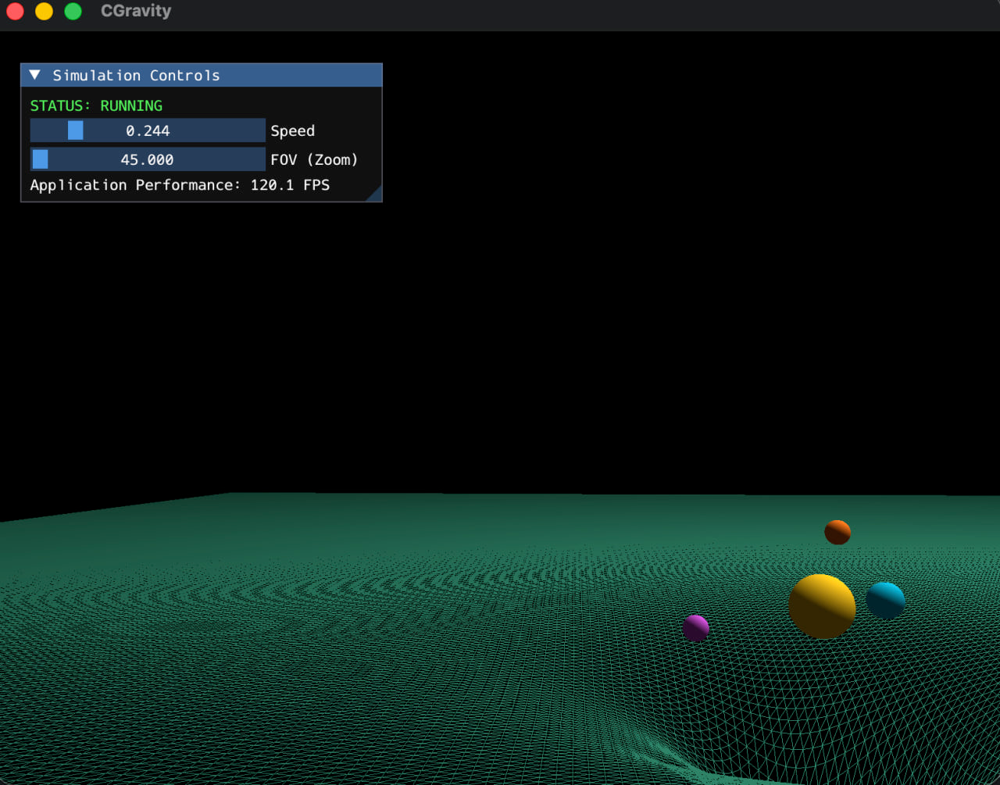

# Cgravity
    Gravity simulation  in C++ and OpenGL

    

## future use refrence, 

i may forget, nah sure i will so :


## Usage
clone add 3rd party libraries :
   ``` git submodule add https://github.com/g-truc/glm external/glm ```
   ``` git submodule add https://github.com/ocornut/imguiexternal/imgui ```

ß
- mkdir & cd to build and run: ``` cmake .. ```
    or from root directory: ``` cmake -S . -B build/ ```


- from root directory run : ``` make && ./prog ```

- then :
    - use up/down arraw key to change the speed
    - use w/a/s/d keys to move within the space
    - use mouse movments to change camera view
    - use mouse scroll to zoom in or out
    - use mouse left click to pause/resume the demo

- for vscode to avoid some lint errors :

    add includes/libraries/externals directories to the includePath in c_cpp_properties.json in .vscode dir:
            "includePath": [
                "${workspaceFolder}/**",
                "${workspaceFolder}/external/glad/include",
                "${workspaceFolder}/includes",
                "${workspaceFolder}/external/glm",
                "/opt/homebrew/include"
            ], 